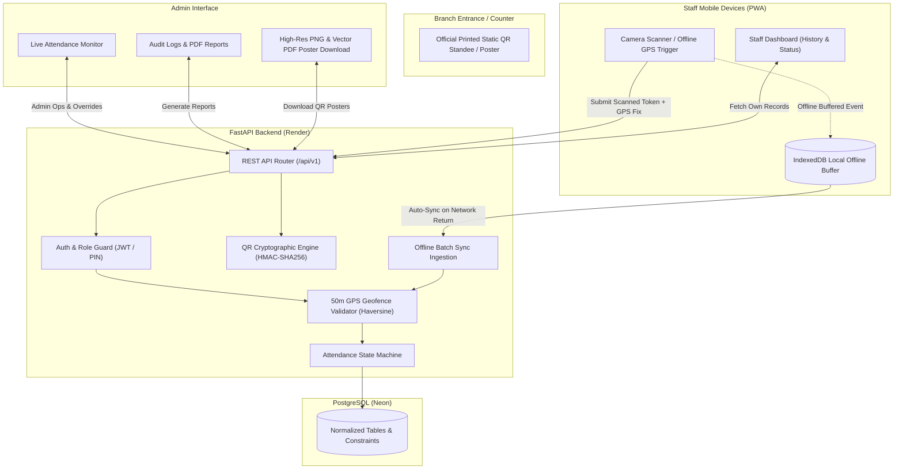

# Shivam Patsanstha – Architecture & Technical Specification

## 1. System Overview
**Shivam Patsanstha** is a single-organization digital attendance management system designed as a mobile-first Progressive Web Application (PWA).

The system replaces manual paper registers with an automated, tamper-proof QR-based attendance workflow. The core guiding principles are:
1. **Single-Tenant Simplicity**: Engineered explicitly for Shivam Patsanstha without unnecessary multi-tenant SaaS overhead.
2. **Server-Authoritative Truth**: All event sequencing, timestamps, and validation occur strictly on the backend. Client clocks and local states are never trusted.
3. **Frictionless Mobile UX**: Lightweight, glassmorphic UI, responsive on iOS Safari and Android Chrome, with full bilingual English & Marathi support.
4. **Auditability & Integrity**: Administrative overrides require logged justifications; QR codes are cryptographically signed and ephemeral to defeat proxy attendance and replay attacks.



---

## 2. Technology Stack & Rationale

| Layer | Technology | Version / Tooling | Architectural Rationale |
| :--- | :--- | :--- | :--- |
| **Frontend Framework** | React + TypeScript | React 18+, TypeScript 5+ | Component-driven, strong typing, mature ecosystem for PWA & mobile. |
| **Build & Bundler** | Vite | Vite 5+ | Near-instant HMR, optimized tree-shaking, lightweight production bundle. |
| **Styling** | Tailwind CSS | Tailwind v3 | Custom glassmorphism utility classes, mobile safe-area insets, responsive tokens. |
| **Routing** | React Router | v6 | Declarative client-side routing, protected routes based on auth/role state. |
| **Icons** | Lucide React | Latest | Clean, lightweight SVG iconography fitting the modern glassmorphic look. |
| **QR Scanner** | html5-qrcode / @zxing | Mobile-compatible | High camera compatibility across iOS Safari (WebKit) and Android Chrome. |
| **PWA Integration** | `vite-plugin-pwa` | Workbox-powered | Offline shell caching, web app manifest, mobile install prompt support. |
| **Backend Framework** | Python + FastAPI | Python 3.10+, FastAPI 0.110+ | High-performance asynchronous API, auto-generated OpenAPI schemas, native Pydantic v2. |
| **ORM & Migrations** | SQLAlchemy + Alembic | SQLAlchemy 2.0 (async/sync), Alembic | Clean declarative models, robust transaction management, versioned schema migrations. |
| **Database** | PostgreSQL | PostgreSQL 15+ (Neon compatible) | Strict constraints (composite uniqueness), ACID transactions, JSONB audit logging. |
| **Authentication** | JWT + Mock/Real OTP | `python-jose` / `pyjwt`, `passlib` | Passwordless phone-based onboarding; decoupled OTP service supporting mock & SMS gateway. |
| **PDF Generation** | ReportLab | v4+ | Server-side pixel-perfect Marathi & English attendance report generation. |

---

## 3. Separation of Concerns & Directory Structure

```
SP-Records/
├── backend/
│   ├── alembic/                # Migration scripts & env configuration
│   ├── app/
│   │   ├── api/
│   │   │   └── v1/
│   │   │       ├── endpoints/  # auth, staff, attendance, qr, admin, reports
│   │   │       ├── deps.py     # Auth & RBAC dependency injectors
│   │   │       └── router.py   # Aggregated API router
│   │   ├── core/
│   │   │   ├── config.py       # Pydantic BaseSettings (env-driven)
│   │   │   ├── security.py     # JWT encode/decode, token verification
│   │   │   └── timezone.py     # Asia/Kolkata date & time handling
│   │   ├── db/
│   │   │   ├── base.py         # Declarative Base
│   │   │   └── session.py      # Engine and SessionLocal factory
│   │   ├── models/             # SQLAlchemy ORM models
│   │   │   ├── organization.py
│   │   │   ├── user.py
│   │   │   ├── role.py
│   │   │   ├── attendance.py
│   │   │   ├── audit.py
│   │   │   └── qr.py
│   │   ├── schemas/            # Pydantic request/response contracts
│   │   ├── repositories/       # Isolated DB query operations
│   │   └── services/           # Pure business logic
│   │       ├── auth_service.py
│   │       ├── attendance_service.py
│   │       ├── qr_service.py
│   │       └── otp_service.py
│   ├── tests/                  # Pytest unit & integration tests
│   ├── alembic.ini
│   ├── requirements.txt
│   └── main.py                 # FastAPI application entrypoint
├── frontend/
│   ├── public/                 # Icons, manifest assets
│   ├── src/
│   │   ├── assets/             # Brand logos & graphics
│   │   ├── components/         # Reusable glassmorphic UI components
│   │   │   ├── common/         # Button, Input, GlassCard, Badge, Modal
│   │   │   └── layout/         # Header, LanguageToggle, BottomNav
│   │   ├── contexts/           # AuthContext, LanguageContext
│   │   ├── features/           # Domain-specific modules
│   │   │   ├── auth/           # Welcome, Phone input, PIN verify
│   │   │   ├── attendance/     # Scanner, Today's status, History list
│   │   │   └── admin/          # Staff list, Live monitor, Corrections, Reports, QR Poster
│   │   ├── hooks/              # useAuth, useTranslation, useCamera
│   │   ├── i18n/               # en.json, mr.json, i18n helper
│   │   ├── routes/             # AppRoutes & ProtectedRoute guards
│   │   ├── services/           # Axios API client & typed endpoints
│   │   ├── styles/             # Tailwind theme & glassmorphic utility classes
│   │   ├── types/              # TypeScript interfaces mirroring API
│   │   ├── App.tsx
│   │   └── main.tsx
│   ├── index.html
│   ├── package.json
│   ├── tsconfig.json
│   ├── tailwind.config.js
│   └── vite.config.ts
├── docs/                       # Architecture & design documentation
└── README.md
```

---

## 4. Role-Based Access Control (RBAC) Architecture

Three access tiers are strictly defined and enforced via FastAPI dependency injection:

1. **Super Admin**:
   - Platform owner. Bootstrapped once via secure environment variable (`SUPER_ADMIN_PHONE`, `SUPER_ADMIN_BOOTSTRAP_TOKEN`).
   - Can promote registered staff to Admin role or revoke Admin privileges.
   - Access to full administrative suite and system health.
2. **Organization Admin**:
   - Manages daily branch operations for Shivam Patsanstha.
   - Views real-time staff status (Present, On Break, Completed, Absent).
   - Performs manual corrections or additions with mandatory written reasons.
   - Generates weekly & monthly PDF reports.
   - Cannot demote the Super Admin or alter system security credentials.
3. **Staff Member**:
   - Self-registers with full name and verified phone number.
   - Scans the rotating office QR code to log attendance events.
   - Views personal attendance records for current day and past history.
   - Read-only access to own profile; blocked from viewing peers' records or accessing admin endpoints.

### Authorization Guard Implementation
```python
# app/api/v1/deps.py pattern
async def get_current_user(...) -> User: ...
async def require_staff(current_user: User = Depends(get_current_user)) -> User: ...
async def require_admin(current_user: User = Depends(get_current_user)) -> User:
    if current_user.role.name not in ["ADMIN", "SUPER_ADMIN"]:
        raise HTTPException(status_code=403, detail="Admin privileges required")
    return current_user
async def require_super_admin(current_user: User = Depends(get_current_user)) -> User:
    if current_user.role.name != "SUPER_ADMIN":
        raise HTTPException(status_code=403, detail="Super Admin privileges required")
    return current_user
```

---

## 5. Security Guardrails
1. **Zero Client Trust**: Timestamps are computed server-side in UTC using `datetime.now(timezone.utc)`.
2. **No Persistent Passwords**: Passwordless phone OTP model removes password stuffing vulnerabilities.
3. **Tamper-Resistant QR**: QR tokens expire in 15–30 seconds, signed with server HMAC-SHA256. Nonces are tracked per user to prevent duplicate scans or replay attacks.
4. **Comprehensive Audit Trail**: Every administrative modification stores previous state, new state, timestamp, actor ID, and mandatory explanation in `attendance_audit_logs`.
5. **CORS & Environment Isolation**: Strict domain whitelisting, separate secrets for JWT and QR signing, and environment validation via Pydantic.

