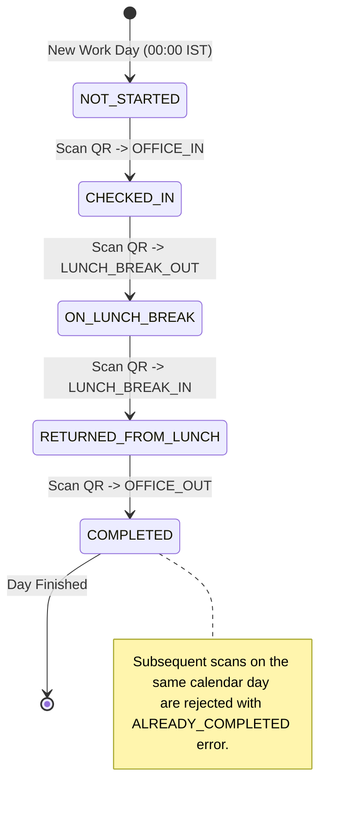

# Shivam Patsanstha – Attendance Workflow & State Machine

## 1. Daily Attendance Lifecycle
Shivam Patsanstha mandates four structured daily attendance checkpoints per staff member:
1. **OFFICE IN**: Arrival at the branch office.
2. **LUNCH BREAK OUT**: Departure for midday meal.
3. **LUNCH BREAK IN**: Return from midday meal.
4. **OFFICE OUT**: Departure at the end of the working day.

The application automatically resolves the next event upon scanning the office QR code. Staff members do not manually select the event, eliminating human error or fraudulent categorization.

---

## 2. State Machine Specification

### States
- `NOT_STARTED`: The staff member has not logged any attendance event for the current calendar date (`Asia/Kolkata`).
- `CHECKED_IN`: Staff is currently present in the office, before lunch break.
- `ON_LUNCH_BREAK`: Staff is out of office for lunch.
- `RETURNED_FROM_LUNCH`: Staff has returned from lunch and is working in the office.
- `COMPLETED`: Staff has checked out for the day (`OFFICE_OUT` recorded). No further scans are accepted.



---

## 3. Transition Rules & Precondition Matrix

| Current State | Next Event Triggered | Required Preconditions | Failure Response / Error Code |
| :--- | :--- | :--- | :--- |
| `NOT_STARTED` | `OFFICE_IN` | No records exist for today. | N/A |
| `CHECKED_IN` | `LUNCH_BREAK_OUT` | `OFFICE_IN` exists. Min 5 mins elapsed since check-in. | `RAPID_SCAN_DETECTED` (if < 5 mins) |
| `ON_LUNCH_BREAK` | `LUNCH_BREAK_IN` | `LUNCH_BREAK_OUT` exists. Min 5 mins elapsed since lunch out. | `RAPID_SCAN_DETECTED` (if < 5 mins) |
| `RETURNED_FROM_LUNCH` | `OFFICE_OUT` | `LUNCH_BREAK_IN` exists. Min 5 mins elapsed since lunch in. | `RAPID_SCAN_DETECTED` (if < 5 mins) |
| `COMPLETED` | *None* | `OFFICE_OUT` already recorded. | `CYCLE_ALREADY_COMPLETED` |

### Enforced Invariants
1. **Strict Monotonic Order**:
   - `LUNCH_BREAK_OUT` cannot occur without `OFFICE_IN`.
   - `LUNCH_BREAK_IN` cannot occur without `LUNCH_BREAK_OUT`.
   - `OFFICE_OUT` cannot occur without `LUNCH_BREAK_IN`.
2. **No Overlapping Events**:
   - The database composite constraint `(user_id, event_date, event_type)` guarantees uniqueness.
3. **Double-Scan Idempotency**:
   - Camera rapid multi-frame detections (e.g. 2 frames read within 500ms) are intercepted by:
     1. Frontend cooldown timer (2.5s lock after detection).
     2. Backend database transaction locking with a minimum scan-spacing threshold.
     3. QR scan uniqueness table (`qr_scan_tracks`).

---

## 4. Timezone & Working Date Normalization
- All physical server timestamps are persisted in `UTC`.
- Working date `event_date` is determined using `Asia/Kolkata` (`UTC+05:30`):
  ```python
  from datetime import datetime, timezone
  from zoneinfo import ZoneInfo

  KOLKATA_TZ = ZoneInfo("Asia/Kolkata")

  def get_current_kolkata_date() -> datetime.date:
      return datetime.now(timezone.utc).astimezone(KOLKATA_TZ).date()
  ```
- If an employee scans at `18:30 UTC` (which is `00:00 IST` next day), it belongs to the next calendar date.

---

## 5. Administrative Exceptions & Corrections
In the real world, an employee may forget to scan `LUNCH_BREAK_OUT` or leave directly for emergency without scanning `OFFICE_OUT`.

### Exception Handling Policy:
1. **Staff cannot manually fix their sequence**: A missing event halts normal progression.
2. **Admin Manual Correction**:
   - Organization Admins can open the employee's daily sheet.
   - Admin can add a missing event (e.g., retroactively inject `LUNCH_BREAK_OUT` at 13:30) or adjust timestamps.
   - Admin **must** submit a textual reason (e.g., *"Employee had field duty at 1:30 PM; approved by Branch Manager"*).
   - An immutable record is created in `attendance_audit_logs`.
   - The event in `attendance_records` has `is_manually_corrected = true`.

