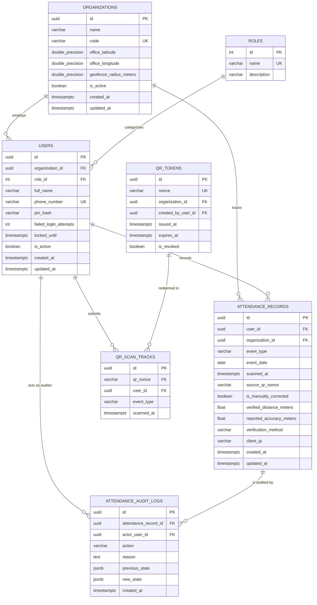

# Shivam Patsanstha – Database Schema Design

## 1. Overview
The database uses a normalized PostgreSQL schema designed for high data integrity, strict auditability, and zero ambiguity regarding attendance states.

All timestamps are stored in UTC (`TIMESTAMP WITH TIME ZONE`). Calendar dates for attendance days are normalized to the `Asia/Kolkata` timezone (`UTC+05:30`) to accurately reflect business working dates regardless of the UTC rollover.

---

## 2. Entity-Relationship Diagram

---

## 3. Detailed Table Specifications

### 3.1 `organizations`
Represents the operating cooperative banking society entity (Shivam Patsanstha) and its registered physical geofence coordinates.
| Column | Type | Constraints | Description |
| :--- | :--- | :--- | :--- |
| `id` | `UUID` | Primary Key, default `gen_random_uuid()` | Unique organization identifier |
| `name` | `VARCHAR(150)` | NOT NULL | Organization name ("Shivam Patsanstha") |
| `code` | `VARCHAR(50)` | NOT NULL, UNIQUE | Organization code identifier ("SHIVAM_PAT") |
| `office_latitude` | `DOUBLE PRECISION` | NULLABLE, DEFAULT `18.1361880` | Official registered office latitude |
| `office_longitude` | `DOUBLE PRECISION` | NULLABLE, DEFAULT `74.5104810` | Official registered office longitude |
| `geofence_radius_meters` | `DOUBLE PRECISION` | NULLABLE, DEFAULT `100.0` | Permitted attendance radius in meters |
| `is_active` | `BOOLEAN` | NOT NULL, DEFAULT true | Status flag |
| `created_at` | `TIMESTAMPTZ` | NOT NULL, DEFAULT `NOW()` | Creation timestamp |
| `updated_at` | `TIMESTAMPTZ` | NOT NULL, DEFAULT `NOW()` | Update timestamp |

---

### 3.2 `roles`
Enumerated role hierarchy (`SUPER_ADMIN`, `ADMIN`, `STAFF`).
| Column | Type | Constraints | Description |
| :--- | :--- | :--- | :--- |
| `id` | `INTEGER` | Primary Key | Role ID |
| `name` | `VARCHAR(50)` | NOT NULL, UNIQUE | `SUPER_ADMIN`, `ADMIN`, `STAFF` |
| `description` | `VARCHAR(255)` | NOT NULL | Human-readable role description |

---

### 3.3 `users`
Registered staff, branch administrators, and super administrators authenticated with a 6-digit numeric PIN.
| Column | Type | Constraints | Description |
| :--- | :--- | :--- | :--- |
| `id` | `UUID` | Primary Key, default `gen_random_uuid()` | Unique user identifier |
| `organization_id` | `UUID` | Foreign Key (`organizations.id`), NOT NULL | Society tenant link |
| `role_id` | `INTEGER` | Foreign Key (`roles.id`), NOT NULL | Assigned role |
| `full_name` | `VARCHAR(120)` | NOT NULL | Employee's full legal name |
| `phone_number` | `VARCHAR(20)` | NOT NULL, UNIQUE, Indexed | E.164 formatted phone number (`+919876543210`) |
| `pin_hash` | `VARCHAR(128)` | NULLABLE | Native bcrypt hash of 6-digit PIN |
| `failed_login_attempts` | `INTEGER` | NOT NULL, DEFAULT 0 | Counter for failed PIN attempts |
| `locked_until` | `TIMESTAMPTZ` | NULLABLE | Temporary lockout timestamp |
| `is_active` | `BOOLEAN` | NOT NULL, DEFAULT true | Account active status |
| `created_at` | `TIMESTAMPTZ` | NOT NULL, DEFAULT `NOW()` | Registration timestamp |
| `updated_at` | `TIMESTAMPTZ` | NOT NULL, DEFAULT `NOW()` | Profile update timestamp |

**Indexes**:
- `ix_users_phone_number` (UNIQUE)

---

### 3.4 `attendance_records`
Stores immutable timestamps and physical verification metadata for the daily four-step attendance lifecycle.
| Column | Type | Constraints | Description |
| :--- | :--- | :--- | :--- |
| `id` | `UUID` | Primary Key, default `gen_random_uuid()` | Record identifier |
| `user_id` | `UUID` | Foreign Key (`users.id`), NOT NULL | Staff member |
| `organization_id` | `UUID` | Foreign Key (`organizations.id`), NOT NULL | Organization link |
| `event_type` | `VARCHAR(30)` | NOT NULL | `OFFICE_IN`, `LUNCH_BREAK_OUT`, `LUNCH_BREAK_IN`, `OFFICE_OUT` |
| `event_date` | `DATE` | NOT NULL | Working date in `Asia/Kolkata` (`YYYY-MM-DD`) |
| `scanned_at` | `TIMESTAMPTZ` | NOT NULL | Server-generated timestamp of scan |
| `source_qr_nonce` | `VARCHAR(100)` | NULLABLE | Tracking reference to the QR token used |
| `is_manually_corrected` | `BOOLEAN` | NOT NULL, DEFAULT false | Flagged true if modified by Admin |
| `verified_distance_meters` | `FLOAT` | NULLABLE | Calculated Haversine distance from office |
| `reported_accuracy_meters` | `FLOAT` | NULLABLE | Device GPS accuracy reported in meters |
| `verification_method` | `VARCHAR(50)` | NOT NULL, DEFAULT `QR_GPS` | `QR_GPS`, `OFFLINE_GPS`, `MANUAL_ADMIN` |
| `client_ip` | `VARCHAR(45)` | NULLABLE | Client IP address at time of scan |
| `created_at` | `TIMESTAMPTZ` | NOT NULL, DEFAULT `NOW()` | Record insertion timestamp |
| `updated_at` | `TIMESTAMPTZ` | NOT NULL, DEFAULT `NOW()` | Record modification timestamp |

**Crucial Constraints & Indexes**:
- **Composite Unique Constraint**: `uq_user_date_event` ON (`user_id`, `event_date`, `event_type`).
  *Enforces at the database engine level that no user can have duplicate events of the same type on the same calendar day.*
- **Compound Index**: `ix_attendance_user_date` ON (`user_id`, `event_date`) for fast daily state queries.
- **Reporting Index**: `ix_attendance_org_date` ON (`organization_id`, `event_date`) for monthly/weekly exports.

---

### 3.5 `attendance_audit_logs`
Tracks any administrative manual additions or modifications with mandatory reason logging.
| Column | Type | Constraints | Description |
| :--- | :--- | :--- | :--- |
| `id` | `UUID` | Primary Key, default `gen_random_uuid()` | Audit identifier |
| `attendance_record_id` | `UUID` | Foreign Key (`attendance_records.id`), NULLABLE | Linked record |
| `actor_user_id` | `UUID` | Foreign Key (`users.id`), NOT NULL | Admin who made the change |
| `action` | `VARCHAR(50)` | NOT NULL | `MANUAL_ADDITION`, `CORRECTION`, `INVALIDATION` |
| `reason` | `TEXT` | NOT NULL | Mandatory explanation entered by admin |
| `previous_state` | `JSONB` | NULLABLE | Snapshot before modification |
| `new_state` | `JSONB` | NOT NULL | Snapshot after modification |
| `created_at` | `TIMESTAMPTZ` | NOT NULL, DEFAULT `NOW()` | Timestamp of audit entry |

---

### 3.6 `qr_tokens` & `qr_scan_tracks`
Token tracking and concurrency validation for attendance QR codes.
| Column | Type | Constraints | Description |
| :--- | :--- | :--- | :--- |
| `id` | `UUID` | Primary Key | Token entry ID |
| `nonce` | `VARCHAR(100)` | NOT NULL, UNIQUE, Indexed | Unique cryptographically generated nonce / jti |
| `organization_id` | `UUID` | Foreign Key (`organizations.id`), NOT NULL | Organization scope |
| `created_by_user_id` | `UUID` | Foreign Key (`users.id`), NOT NULL | Admin issuer user |
| `issued_at` | `TIMESTAMPTZ` | NOT NULL | Token creation time |
| `expires_at` | `TIMESTAMPTZ` | NOT NULL | Token expiration time |
| `is_revoked` | `BOOLEAN` | NOT NULL, DEFAULT false | Administrative revocation |

`qr_scan_tracks`:
| Column | Type | Constraints | Description |
| :--- | :--- | :--- | :--- |
| `id` | `UUID` | Primary Key | Tracking ID |
| `qr_nonce` | `VARCHAR(100)` | NOT NULL, Indexed | Nonce reference |
| `user_id` | `UUID` | Foreign Key (`users.id`), NOT NULL | Staff who redeemed it |
| `event_type` | `VARCHAR(30)` | NOT NULL | Attendance event triggered |
| `scanned_at` | `TIMESTAMPTZ` | NOT NULL, DEFAULT `NOW()` | Scan time |

**Constraint**:
- `uq_qr_user_scan` ON (`qr_nonce`, `user_id`) ensures a staff member cannot replay the exact same QR scan twice, while allowing colleagues to scan the shared office QR poster throughout the day.
