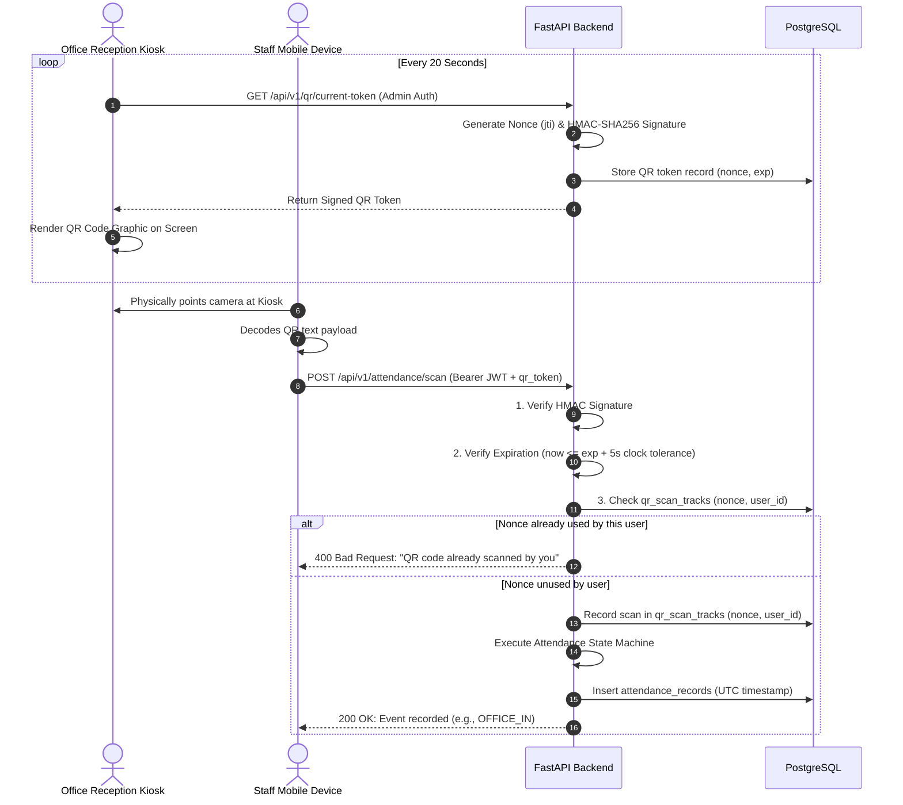

# Shivam Patsanstha – QR Code Security Architecture

## 1. Threat Model & Design Requirements
Static QR codes (such as printed stickers on office walls) are fundamentally insecure:
- An employee can photograph the sticker and share it via WhatsApp.
- Absent employees can scan the photo from home and fake attendance.
- Captured network payloads can be replayed repeatedly.

To ensure physical presence at Shivam Patsanstha, the system implements a **Cryptographically Signed Rotating QR Code Architecture**.

---

## 2. Threat Analysis & Mitigations

| Threat | Attack Vector | System Defense |
| :--- | :--- | :--- |
| **Remote Proxy Attendance** | Employee photographs office QR and shares it via messaging app. | **Short Lifespan (15–25 seconds)**: QR token expires before it can be transmitted and scanned off-site. |
| **Token Replay Attack** | Intercepting a valid QR string and resubmitting it later. | **Backend Nonce Tracking**: Tokens have an absolute expiration and server-side tracking. |
| **Duplicate Rapid Scans** | Staff member scans the same rotating QR multiple times in 10 seconds. | **Per-User Nonce Redemption**: A staff member can use a specific QR nonce only once (`uq_qr_user_scan`). |
| **Token Forgery** | Attacker crafts a fake QR payload with arbitrary timestamps. | **HMAC-SHA256 Cryptographic Signature**: Secret key is securely kept on the backend. |
| **Shared Line Bottleneck** | Multiple employees queueing at the office entrance at 9:00 AM. | **Multi-User Concurrency**: The same active rotating QR can be scanned by all employees standing at the door within its 20s window. |

---

## 3. Cryptographic Token Structure

The office kiosk (tablet or monitor at branch reception) requests a signed token from `/api/v1/qr/rotate`.

### Token Payload
```json
{
  "jti": "8f8b66f2-49b0-4dbb-b235-93116df16e2b",
  "org_id": "a1b2c3d4-0000-0000-0000-000000000001",
  "iat": 1731564000,
  "exp": 1731564025,
  "type": "OFFICE_ROTATING_QR"
}
```

The payload is signed using **HMAC-SHA256** with `QR_SIGNING_SECRET`:
```
QR_TOKEN = Base64Url(Header) + "." + Base64Url(Payload) + "." + Signature
```

---

## 4. Verification Flow



---

## 5. Mobile Camera & PWA Implementation Details
1. **Camera Permissions**:
   - Access requested using `navigator.mediaDevices.getUserMedia({ video: { facingMode: "environment" } })`.
   - Clear UI fallbacks for camera permission denial (instructions on enabling camera in Safari/Chrome settings).
2. **Scanner Cooldown**:
   - Immediate UI feedback upon visual QR capture: camera stream paused or frozen to prevent duplicate requests.
   - 2.5-second debounce window before camera resumes scanning if error occurred.
3. **Transport Security**:
   - HTTPS mandatory for both camera hardware access and transmission of QR tokens.

