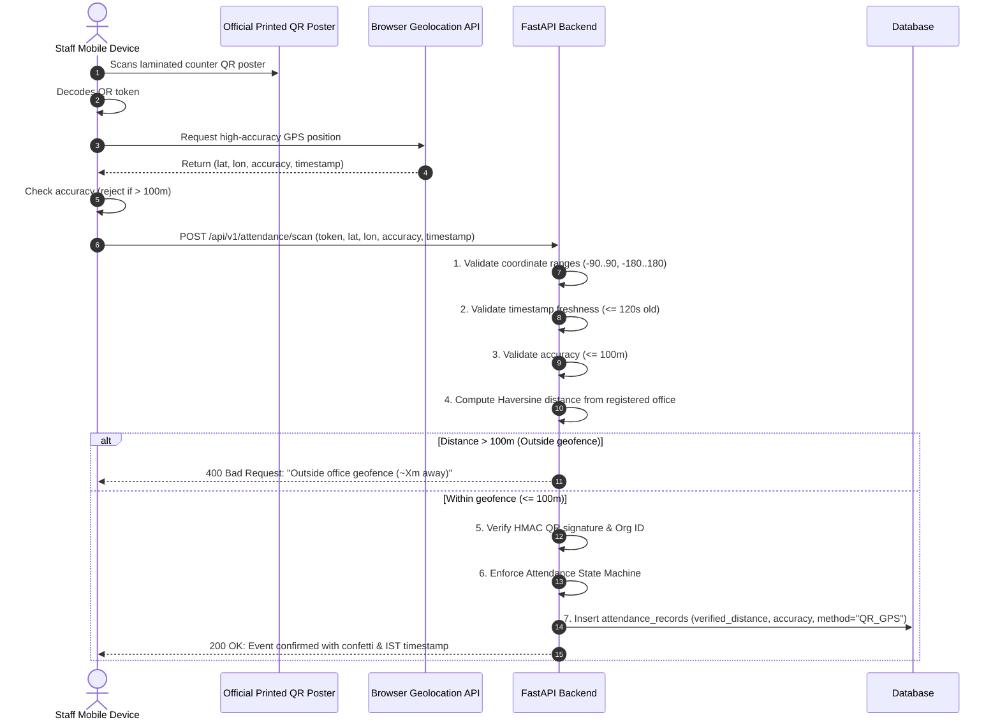

# Shivam Patsanstha – Attendance Security & Verification Architecture

## 1. Threat Model & Design Requirements
In rural cooperative societies (Pat Sansthas), relying on dedicated tablets or display monitors (kiosks) introduces major operational friction:
- **High Hardware & Maintenance Overhead**: Branch tablets risk damage, theft, battery degradation, and screen failures.
- **Power Cuts & Load Shedding**: Rural electricity cuts can take kiosk screens offline during morning check-in rushes.
- **Counter Congestion**: Staff line up in front of a single monitor to mark attendance.

To solve this while retaining 100% cryptographic security, the system combines an **Official Printable Static QR Poster** with **Server-Side GPS Geofencing (100m)** and an **Offline-First Synchronization Engine**.

---

## 2. Threat Analysis & Mitigations

| Threat | Attack Vector | System Defense |
| :--- | :--- | :--- |
| **Remote Proxy Attendance** | Employee photographs office QR sticker and shares it with absent colleagues via WhatsApp. | **Server-Side GPS Geofence (100m)**: Device GPS coordinates are calculated on the backend via the Haversine formula against office coordinates (`18.1361880, 74.5104810`). An absent employee at home scanning the photo is immediately rejected. |
| **GPS Spoofing / Mock Location** | User uses mock GPS developer apps to spoof coordinates. | **Hardware GNSS Validation & Freshness**: Coordinates require high accuracy ($\le 100$m, preferred $\le 50$m) and timestamps $\le 120$s old. |
| **Rapid Duplicate Scans** | Staff member repeatedly taps or scans within seconds. | **Debounce Window**: Configurable minimum spacing (10–15s) enforced by server state machine. |
| **Token Forgery** | Attacker crafts a fake QR code. | **HMAC-SHA256 Cryptographic Signature & Org Scoping**: QR token encodes signed organization identifier and is validated against the server key. |
| **Rural Power / Network Cut** | Mobile data or Wi-Fi is unavailable at the branch. | **Offline IndexedDB Storage**: Smartphone GNSS satellites work without cellular data; check-ins are buffered in local IndexedDB and auto-synced upon reconnect (`POST /api/v1/attendance/sync-offline`). |

---

## 3. Cryptographic Token Structure

The organization's permanent official attendance token is cryptographically signed using HMAC-SHA256:

### Token Payload
```json
{
  "jti": "PERM_OFFICE_QR_SHIVAM_PATSANSTHA_MAIN",
  "org_id": "a1b2c3d4-0000-0000-0000-000000000001",
  "org_code": "SHIVAM_PATSANSTHA_MAIN",
  "type": "PERMANENT_OFFICE_QR"
}
```

The payload is signed using **HMAC-SHA256** with `QR_SIGNING_SECRET`:
```
QR_TOKEN = Base64Url(Header) + "." + Base64Url(Payload) + "." + Signature
```

Admins can download:
1. **High-Resolution PNG (1500 × 1500 px, 300 DPI)** for counter stands or stickers.
2. **Official A4 PDF Poster** via ReportLab with bilingual instructions and security seals ready to laminate.

---

## 4. Physical Presence Verification & Server-Side GPS Geofencing

### 4.1 Architecture Principles
1. **Native Browser Geolocation**: Zero third-party paid location APIs. Uses native HTML5 `navigator.geolocation.getCurrentPosition` with `enableHighAccuracy: true`.
2. **Server-Side Final Authority**: Frontend coordinates are never blindly trusted. The backend recalculates great-circle distance using the Haversine formula against registered office coordinates.
3. **Privacy & Employee Protection**: Staff are **not** continuously tracked. GPS is only queried at the moment of scanning. Raw coordinates are never logged or exposed in staff-facing views. Only the calculated distance (`verified_distance_meters`) and reported accuracy (`reported_accuracy_meters`) are persisted.

### 4.2 Official Office Coordinates & Thresholds
- **Official Registered Office**: Shivam Patsanstha, Phaltan
- **Latitude**: `18.1361880`
- **Longitude**: `74.5104810`
- **Permitted Geofence Radius**: `100.0` meters
- **Preferred GPS Accuracy**: $\le 50.0$ meters
- **Maximum Acceptable Accuracy**: $\le 100.0$ meters (scans with accuracy $>100$m are rejected with clear user retry guidance)
- **Location Timestamp Freshness**: $\le 120$ seconds (prevents coordinate replay attacks)

### 4.3 Mathematical Formula (Haversine)
The great-circle distance $d$ in meters between office $(\phi_1, \lambda_1)$ and staff device $(\phi_2, \lambda_2)$ is computed as:
$$\Delta\phi = \phi_2 - \phi_1, \quad \Delta\lambda = \lambda_2 - \lambda_1$$
$$a = \sin^2\left(\frac{\Delta\phi}{2}\right) + \cos(\phi_1)\cos(\phi_2)\sin^2\left(\frac{\Delta\lambda}{2}\right)$$
$$c = 2 \cdot \operatorname{atan2}\left(\sqrt{a}, \sqrt{1-a}\right)$$
$$d = R \cdot c \quad \text{where } R = 6,371,000 \text{ meters}$$

---

## 5. Verification Workflow Sequence



---

## 6. Offline-First Synchronization Architecture

When connectivity is unavailable:
1. The smartphone GNSS chip obtains hardware satellite positioning.
2. The scan event, coordinates, accuracy, and timestamp are saved in client-side **IndexedDB** (`SPAttendanceOfflineDB`).
3. The UI indicates pending offline records with an amber badge in the header.
4. When connectivity returns, records are synchronized via `POST /api/v1/attendance/sync-offline`.
5. The backend validates chronological integrity, geofence validity, and records them with `verification_method="OFFLINE_GPS"`.
