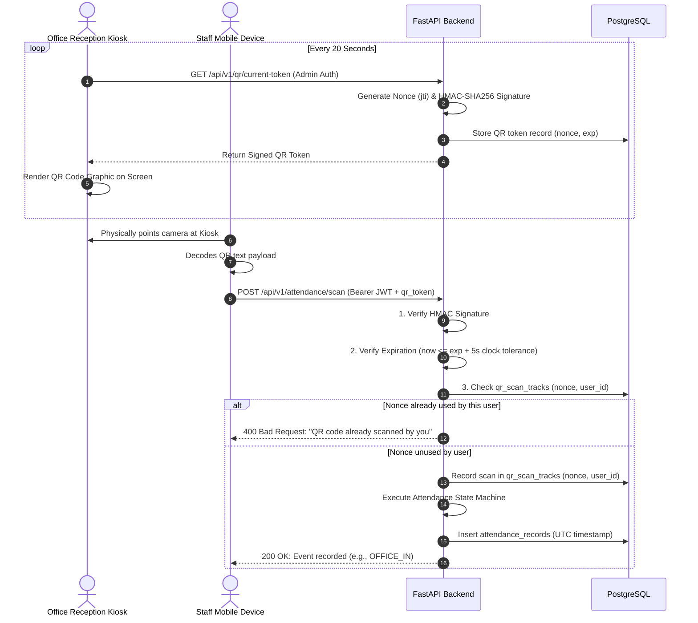
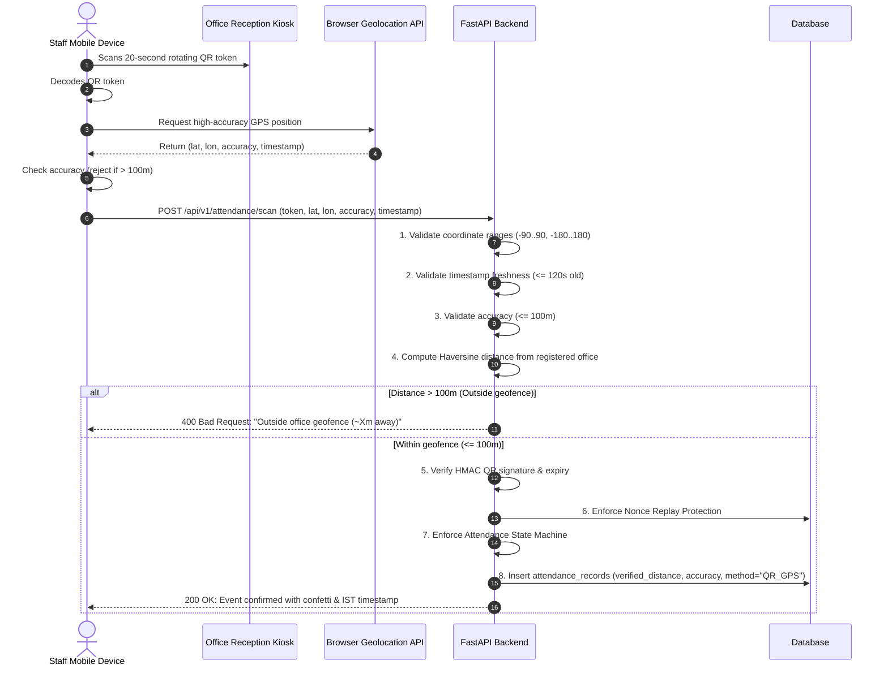

# Shivam Patsanstha – QR Code Security Architecture

## 1. Threat Model & Design Requirements
Static QR codes (such as printed stickers on office walls) are fundamentally insecure:
- An employee can photograph the sticker and share it via WhatsApp.
- Absent employees can scan the photo from home and fake attendance.
- Captured network payloads can be replayed repeatedly.

To ensure physical presence at Shivam Patsanstha, the system implements a **Cryptographically Signed Rotating QR Code Architecture**.

---

## 2. Threat Analysis & Mitigations

| Threat | Attack Vector | System Defense |
| :--- | :--- | :--- |
| **Remote Proxy Attendance** | Employee photographs office QR and shares it via messaging app. | **Short Lifespan (15–25 seconds)**: QR token expires before it can be transmitted and scanned off-site. |
| **Token Replay Attack** | Intercepting a valid QR string and resubmitting it later. | **Backend Nonce Tracking**: Tokens have an absolute expiration and server-side tracking. |
| **Duplicate Rapid Scans** | Staff member scans the same rotating QR multiple times in 10 seconds. | **Per-User Nonce Redemption**: A staff member can use a specific QR nonce only once (`uq_qr_user_scan`). |
| **Token Forgery** | Attacker crafts a fake QR payload with arbitrary timestamps. | **HMAC-SHA256 Cryptographic Signature**: Secret key is securely kept on the backend. |
| **Shared Line Bottleneck** | Multiple employees queueing at the office entrance at 9:00 AM. | **Multi-User Concurrency**: The same active rotating QR can be scanned by all employees standing at the door within its 20s window. |

---

## 3. Cryptographic Token Structure

The office kiosk (tablet or monitor at branch reception) requests a signed token from `/api/v1/qr/rotate`.

### Token Payload
```json
{
  "jti": "8f8b66f2-49b0-4dbb-b235-93116df16e2b",
  "org_id": "a1b2c3d4-0000-0000-0000-000000000001",
  "iat": 1731564000,
  "exp": 1731564025,
  "type": "OFFICE_ROTATING_QR"
}
```

The payload is signed using **HMAC-SHA256** with `QR_SIGNING_SECRET`:
```
QR_TOKEN = Base64Url(Header) + "." + Base64Url(Payload) + "." + Signature
```

---

## 4. Verification Flow



---

## 5. Mobile Camera & PWA Implementation Details
1. **Camera Permissions**:
   - Access requested using `navigator.mediaDevices.getUserMedia({ video: { facingMode: "environment" } })`.
   - Clear UI fallbacks for camera permission denial (instructions on enabling camera in Safari/Chrome settings).
2. **Scanner Cooldown**:
   - Immediate UI feedback upon visual QR capture: camera stream paused or frozen to prevent duplicate requests.
   - 2.5-second debounce window before camera resumes scanning if error occurred.
3. **Transport Security**:
   - HTTPS mandatory for both camera hardware access and transmission of QR tokens.

---

## 6. Physical Presence Verification & Server-Side GPS Geofencing (Phase 2.3)

To eliminate the vulnerability where a staff member photographs the rotating QR code and relays it via messaging to mark remote attendance, the application mandates **physical presence verification** combining rotating HMAC QR with **Server-Side GPS Geofencing**.

### 6.1 Architecture Principles
1. **Native Browser Geolocation**: Zero third-party paid location APIs or external tracking subscriptions. Uses native HTML5 `navigator.geolocation.getCurrentPosition` with `enableHighAccuracy: true`.
2. **Server-Side Final Authority**: Frontend coordinates are never blindly trusted. The backend recalculates great-circle distance using the Haversine formula against official office coordinates.
3. **Privacy & Employee Protection**: Staff are **not** continuously tracked. GPS is only queried at the moment of scanning. Raw coordinates are never logged or exposed in staff-facing views. Only the calculated distance (`verified_distance_meters`) and reported accuracy (`reported_accuracy_meters`) are persisted.

### 6.2 Official Office Coordinates & Thresholds
- **Official Registered Office**: Shivam Patsanstha, Phaltan
- **Latitude**: `18.1361880`
- **Longitude**: `74.5104810`
- **Permitted Geofence Radius**: `100.0` meters
- **Preferred GPS Accuracy**: $\le 50.0$ meters
- **Maximum Acceptable Accuracy**: $\le 100.0$ meters (scans with accuracy $>100$m are rejected with clear user retry guidance)
- **Location Timestamp Freshness**: $\le 120$ seconds (prevents coordinate replay attacks)

### 6.3 Mathematical Formula (Haversine)
The great-circle distance $d$ in meters between office $(\phi_1, \lambda_1)$ and staff device $(\phi_2, \lambda_2)$ is computed as:
$$\Delta\phi = \phi_2 - \phi_1, \quad \Delta\lambda = \lambda_2 - \lambda_1$$
$$a = \sin^2\left(\frac{\Delta\phi}{2}\right) + \cos(\phi_1)\cos(\phi_2)\sin^2\left(\frac{\Delta\lambda}{2}\right)$$
$$c = 2 \cdot \operatorname{atan2}\left(\sqrt{a}, \sqrt{1-a}\right)$$
$$d = R \cdot c \quad \text{where } R = 6,371,000 \text{ meters}$$

### 6.4 Verification Workflow Sequence


### 6.5 Super Admin Configuration & Manual Adjustments
- **Dynamic Office Location Configuration**: Super Admin can inspect and reconfigure office coordinates or radius with mandatory justification via `GET /api/v1/admin/office-location` and `PATCH /api/v1/admin/office-location`.
- **Manual Exception Tracking**: Legitimate exceptions (e.g. employee phone broken) can be recorded by Admin via `POST /api/v1/admin/attendance/manual-add` with mandatory justification, tagged with `verification_method="MANUAL_ADMIN"`, and logged in the immutable audit trail.


